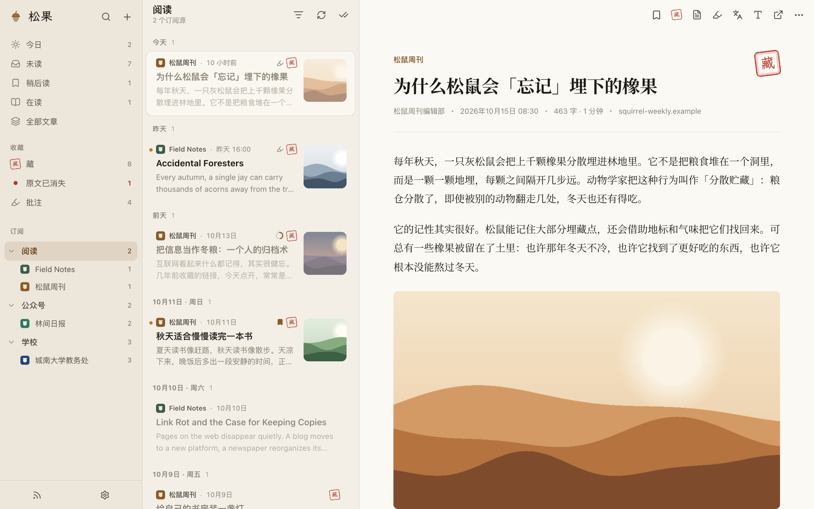
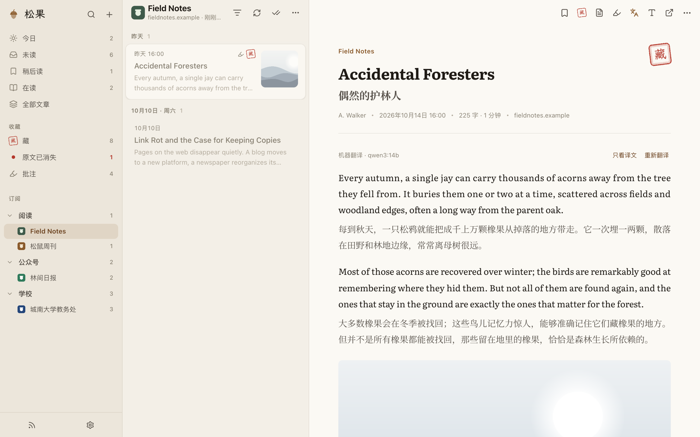
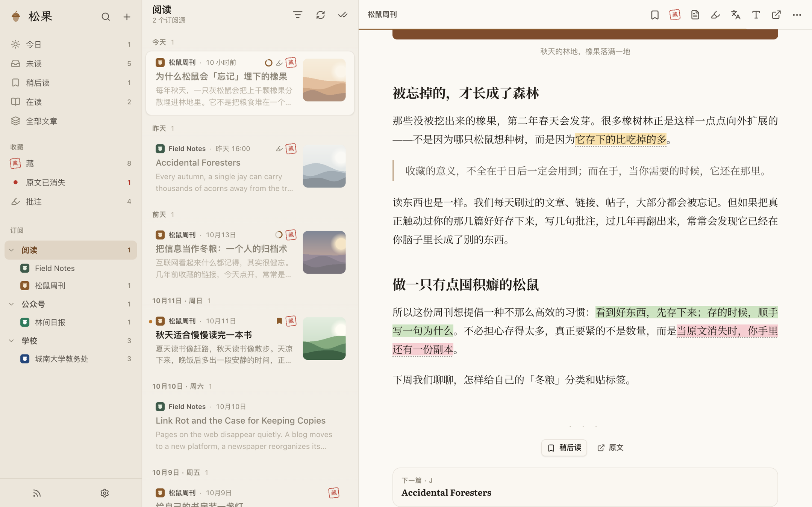
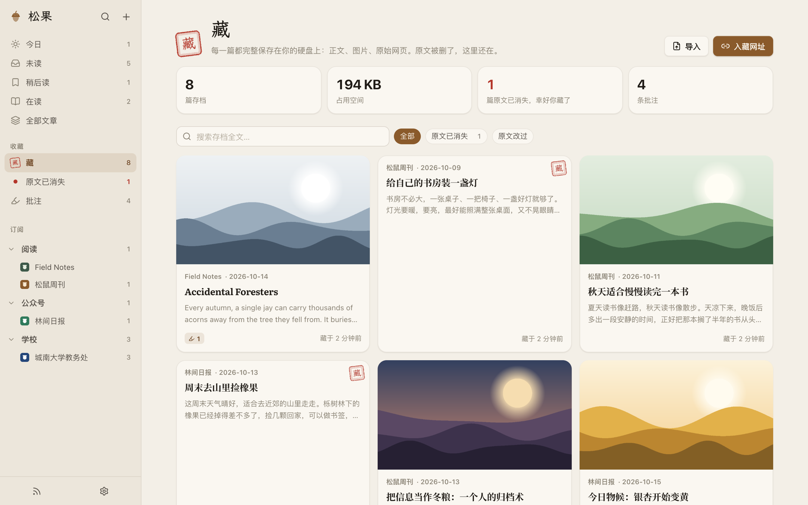
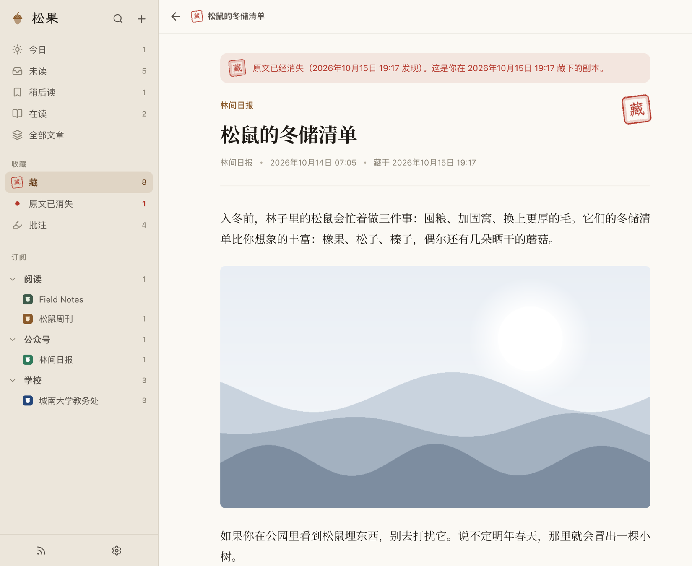
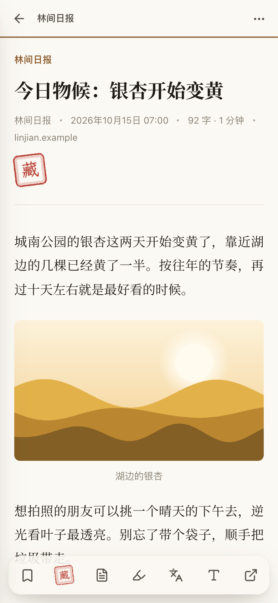
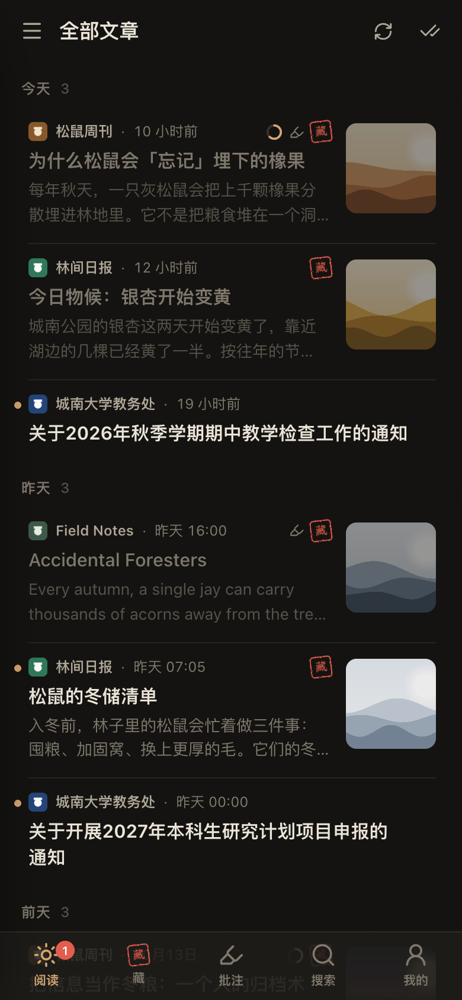

# 松果 Acorn

完全属于你的信息系统：订阅、阅读、批注、**本地存档**。为松鼠党而做——喜欢的就先藏起来，原文被删了，你的副本还在。

> **English** — Acorn is a self-hosted reader and personal web archive: RSS/Atom/JSON Feed, RSSHub, scraped pages and
> plugins in; a fast PWA reader with highlights, immersive translation (local Ollama or any OpenAI-compatible/Claude API)
> and a Google Reader API out; every article you care about saved to plain files on your disk, rechecked so you notice
> when the original disappears. Built to be extended by coding agents (CLI, MCP server, `AGENTS.md`). The interface is
> in Chinese. Node.js ≥ 22.18, no native modules. License: AGPL-3.0.



- **订阅一切**：RSS / Atom / JSON Feed、RSSHub 路由、没有 RSS 的网页（学院通知、部门公告，自动识别列表）、用 TypeScript 写的插件源，以及微信公众号（接上 we-mp-rss 后自动同步）。
- **好读**：宋体 / 霞鹜文楷 / 黑体三套阅读字体，纸、米、夜、墨四种主题，首行缩进、两端对齐，摘要型订阅自动抓全文。手机上是一个可以装到主屏幕的 App。
- **入藏**：一键（或标星、批注时自动）把正文、图片、附件、原始网页存到你自己的硬盘；遇到公众号、小红书、知乎这类有登录或验证的网站，可以用你自己登录过的浏览器（ego-browser）入藏，连同整页快照 MHTML 和截图。
- **搬家**：浏览器书签、Pocket、Instapaper、Raindrop、Readwise 的导出文件拖进来，里面的链接逐个入藏；原文已经 404 的，去 Internet Archive 找回当年的副本。
- **盯着原文**：定期回访存档的原文，被删了就标出来，被改了就另存一个版本。
- **翻译**：外文文章逐段双语对照，或只看译文；列表里的外文标题也能顺手译好。用本机模型（Ollama，免费、离线）或云端 API（DeepSeek、通义千问、OpenAI、Claude…）；译文缓存在本地，每台设备共享。
- **要点**：长文一键提炼 3–5 条要点（快捷键 I），和翻译用同一个模型，生成一次、各设备共享。
- **批注**：高亮、写想法，导出 Markdown 直接进 Obsidian。
- **多设备同步**：手机、平板、Linux、Mac 共用同一份已读状态、阅读进度、批注和阅读偏好；也可以用 Reeder、NetNewsWire、Read You、Capy Reader 等原生阅读器连接（Google Reader 兼容接口）。
- **Agent 友好**：命令行 `acorn`、MCP 服务器、给 Agent 看的 `AGENTS.md` 和 skill，让 Claude Code / Hermes 直接帮你加源、写抓取规则、整理存档。

## 看看样子

| | |
|---|---|
|  |  |
| **翻译**：外文文章逐段双语对照，这张用的是本机的 qwen3:14b | **批注**：划线、写想法，批注过的文章自动入藏 |
|  |  |
| **藏**：每篇存档都是硬盘上的普通文件 | **原文没了，副本还在**：回访发现原文被删，会标出来 |

<p align="center">
  
  &nbsp;&nbsp;
  
</p>
<p align="center">手机上是一个可以装到主屏幕的 App，跟随系统的深色模式</p>

> 截图里的订阅源、文章和配图都是为演示写的虚构内容。

## 快速开始

需要 Node.js 22.18 或更新版本（服务端直接运行 TypeScript，数据库用 Node 自带的 SQLite，没有需要编译的依赖）。

```bash
npm install
npm run build      # 构建网页界面
npm start          # 启动，默认 http://localhost:7700
```

第一次在**这台电脑**的浏览器里打开 <http://localhost:7700>，设置密码。之后手机、平板用同一个密码登录。

常用配置写在项目根目录的 `.env`（参考 `.env.example`）：

| 变量 | 作用 | 默认 |
|---|---|---|
| `ACORN_PORT` | 端口 | `7700` |
| `ACORN_HOST` | 监听地址；只想本机用就设为 `127.0.0.1` | `0.0.0.0` |
| `ACORN_DATA_DIR` | 数据目录 | `./data` |
| `ACORN_PUBLIC_URL` | 摘要和通知里用的访问地址，比如 Tailscale 地址 | `http://localhost:7700` |
| `RSSHUB_BASE` | RSSHub 实例 | `https://rsshub.app` |
| `ACORN_WAYBACK_BASE` | 搬家时找回失效链接用的 Internet Archive 地址 | `https://web.archive.org` |
| `TELEGRAM_BOT_TOKEN` / `TELEGRAM_CHAT_ID` | 每日摘要 | 空 |

## 在各个设备上用

- **扫码登录**：「设置 → 多设备 → 扫码在手机上登录」，手机相机扫一下就进松果，不用输地址和密码（链接 10 分钟内有效、只能用一次）；终端里运行 `./bin/acorn login-link` 也行。然后在浏览器菜单里「添加到主屏幕」。
- **同一局域网**：手机浏览器打开 `http://<这台电脑的局域网 IP>:7700`，「添加到主屏幕」。
- **出门在外**：推荐 [Tailscale](https://tailscale.com)：电脑和手机都装上，用 Tailscale 给的地址访问，不需要把松果暴露到公网。
- **原生阅读器**：在 Reeder、NetNewsWire、Read You、Capy Reader、NewsFlash 里添加 FreshRSS / Google Reader API 账号，服务器填松果地址，用户名随意，密码填松果密码。在阅读器里加星标，松果会自动入藏。
- **随手收藏**：设置页里有书签小工具；安卓可以从分享菜单直接分享给松果；iPhone 用快捷指令打开 `…/capture?url=`。

## 消息源

| 来源 | 怎么订阅 |
|---|---|
| 博客、新闻、播客、YouTube、GitHub | 直接粘贴网址，松果会自己找到 RSS；「添加订阅」里也有一组常用来源，点一下就能预览 |
| B 站、微博、知乎、抖音… | RSSHub 路由，比如 `rsshub://bilibili/user/dynamic/2267573`。需要 Cookie 的路由建议自建 RSSHub（见下文 Docker） |
| 学校院系、部门通知页 | 直接粘贴列表页网址，松果自动识别文章列表和日期；附件会在入藏时一起下载 |
| 微信公众号 | 自建 [we-mp-rss](https://github.com/rachelos/we-mp-rss)（`services/we-mp-rss/ctl.sh up` 一键起容器），在「设置 → 微信公众号」填它的地址，之后在 we-mp-rss 里加的号会自动出现在松果里。也可以订阅 [Wechat2RSS](https://wechat2rss.xlab.app) 公开收录的号 |
| 小红书、需要登录的页面 | 在文章上选「用我的浏览器入藏」，或订阅后让 Agent 写插件 |
| 任何奇怪的网站 | 在 `plugins/` 写一个插件（见 `docs/plugins.md`），可以让 Claude Code 帮你写 |

> 微信经常对服务器直接抓取的文章返回「环境异常」验证页（和是否走代理无关）。来自 we-mp-rss 的文章自带全文，松果直接用它入藏，不去碰原网页；其他情况松果会识别出验证页并提示你，在你自己的浏览器里完成验证后用「浏览器入藏」即可。松果不会尝试自动过验证码。

## 翻译

阅读栏的「译」按钮（快捷键 T）把当前文章逐段译成中文，译文排在原文下面；也可以切换成只看译文，或者在设置里打开「外文文章自动翻译」。在「设置 → 翻译」选择引擎：

- **本机模型**：装好 [Ollama](https://ollama.com) 后下载一个模型，比如 `ollama pull qwen3:8b`（约 5 GB，16 GB 内存的电脑就能跑）或 `qwen3:14b`（约 9 GB，译文更好）。文章不离开你的电脑。松果在 Docker 里运行时，地址填 `http://host.docker.internal:11434`。
- **云端 API**：DeepSeek、通义千问、OpenAI、Claude，或任何 OpenAI 兼容接口（OpenRouter、硅基流动、LM Studio…）。填 API Key 即可，按量付费，文章会发给服务商。

译文按段落缓存在本地数据库里：同一段只翻一次，换台设备打开也不用再等。批注只能划在原文上，关掉翻译后依然在原处。

同一个模型还负责两件事：
- **列表标题**：「设置 → 翻译与要点 → 翻译列表里的外文标题」打开后，英文源的标题下面会多一行中文，新文章刷新时就先译好；
- **要点**：阅读栏的「要点」按钮（快捷键 I）把长文提炼成 3–5 条，存档里也能用。

## 搬家

别处攒了多年的收藏可以整个搬进来：「藏 → 搬家」，把导出文件拖进去——浏览器书签（Chrome、Safari、Firefox、Edge 导出的 HTML）、Pocket、Instapaper、Raindrop、Readwise Reader 的 CSV，或任何带网址的 CSV、JSON、文本。松果先告诉你里面有多少链接、哪些已经在藏里，然后在后台逐个抓取正文、下载图片；书签文件夹和原来的标签都变成松果的标签。

老链接很多早就打不开了。打开「原文消失时从 Internet Archive 找回」，松果会去 Wayback Machine 找离你收藏时间最近的一份快照存下来，并标明来源；没找到的单独列出。中途关掉松果也没关系，重启后接着搬。命令行：`./bin/acorn import bookmarks.html --tag 书签`（加 `--dry-run` 只看不搬）。

已经藏下、后来原文消失的文章，阅读页顶部也有「找 Internet Archive 的副本」。

## 入藏与文件

每份存档都是普通文件，不依赖松果也能打开：

```
data/archive/2026/10/<标题>-<id>/<时间戳>/
  article.html    离线阅读页（双击就能看，含本地图片）
  article.md      Markdown
  content.html    正文片段（松果内部使用）
  source.html     原始网页
  page.mhtml      整页快照（浏览器入藏时）
  screenshot.png  整页截图（浏览器入藏时）
  assets/         图片
  attachments/    附件（PDF、Office 文件等）
  meta.json       元数据
```

同一篇文章再入藏时，内容没变就不会重复保存；变了就新增一个时间戳目录，作为新版本。

## 让 Agent 接管

- 命令行：`./bin/acorn help`（所有命令都支持 `--json`）
- MCP：`claude mcp add acorn -- node --disable-warning=ExperimentalWarning <项目路径>/src/mcp/server.ts`
- Hermes / 其他 Agent：读 `AGENTS.md` 和 `skills/acorn/SKILL.md`
- 把任何订阅源再输出成 RSS：`/out/feed/<id>.xml?key=<令牌>`，TrendRadar 之类的工具可以直接订阅松果加工过的源

## 一直运行

- **macOS 开机自启**：`scripts/install-launchd.sh`（卸载：`scripts/uninstall-launchd.sh`）
- **Docker**：`ACORN_PASSWORD=你的密码 docker compose -f docker/compose.yml up -d`，同时会启动一个自建的 RSSHub。容器里不会出现网页上的「首次设置密码」，所以第一次的密码用环境变量给；之后在设置页改，或用 `docker compose -f docker/compose.yml exec acorn ./bin/acorn passwd 新密码`
- **备份**：备份整个 `data/` 目录即可

## 开发

```bash
npm run dev        # 服务端（文件变动自动重启）
npm run dev:web    # 前端热更新，访问 http://localhost:5173
npm test           # 测试
npm run typecheck
```

结构见 `AGENTS.md`；改代码前请先读它。

## 许可证

[GNU AGPL-3.0](LICENSE)。你可以自由使用、修改和分发松果；如果把修改过的松果作为网络服务提供给别人使用，也需要向这些用户公开你的修改。

界面字体来自 npm 依赖 Literata、Noto Serif SC 和霞鹜文楷屏幕阅读版（LXGW WenKai Screen），均以 SIL Open Font License 1.1 授权。
