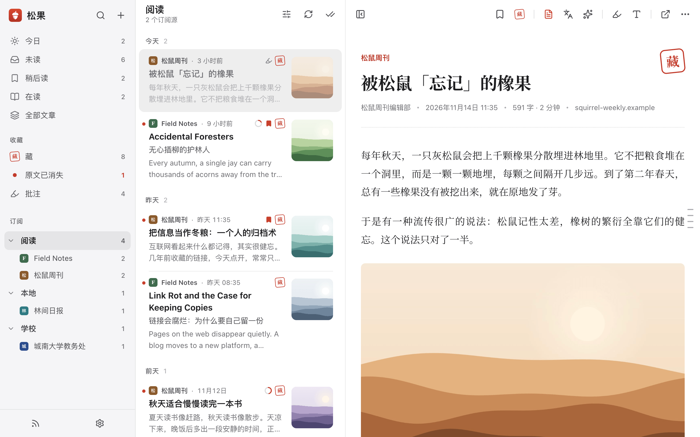
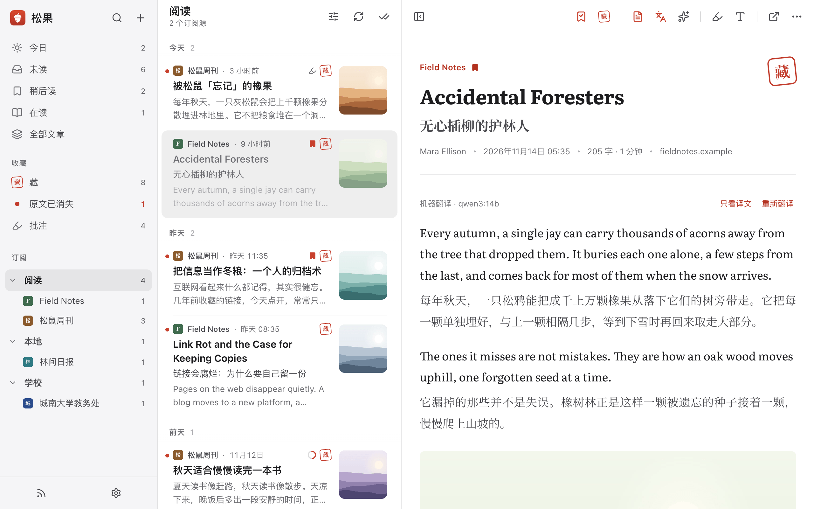
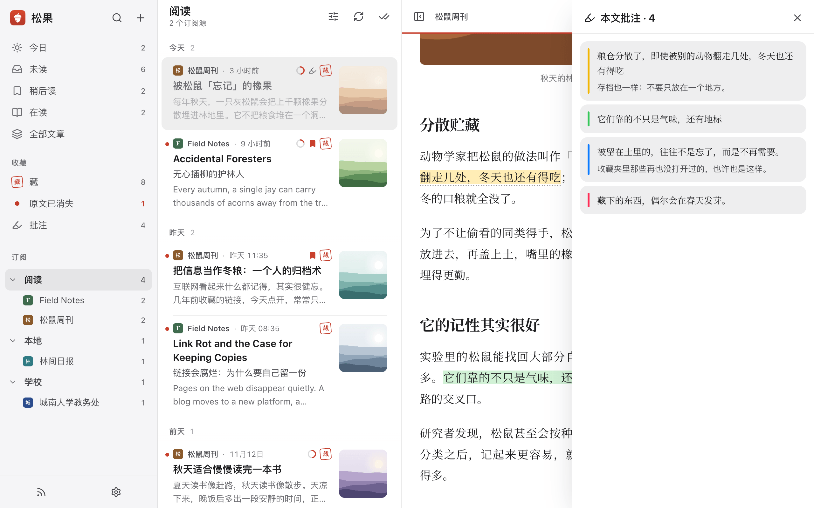
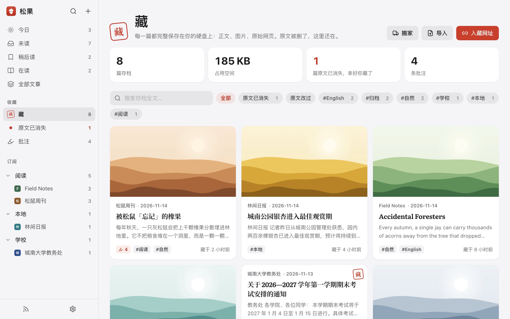
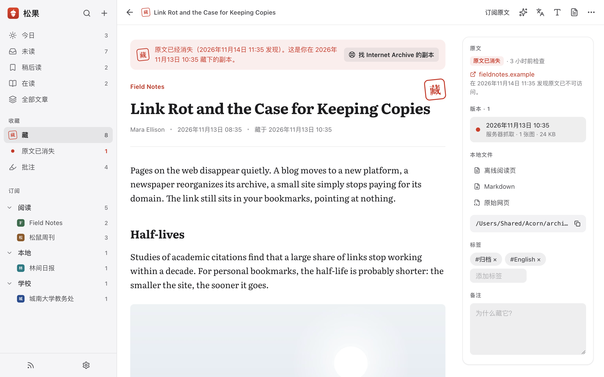
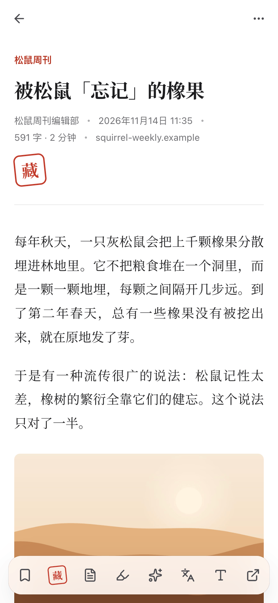
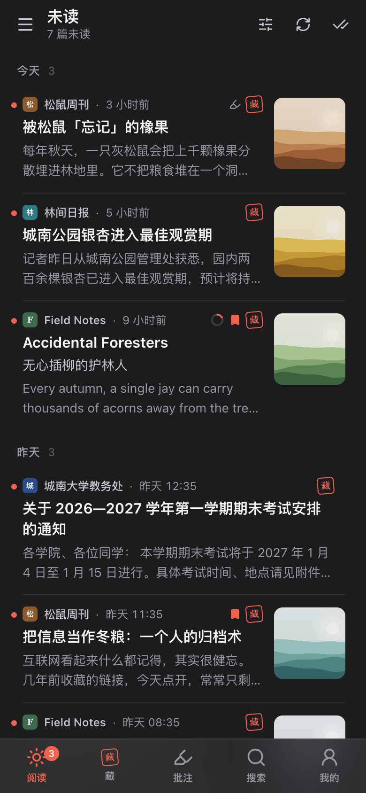

# 松果 Acorn

完全属于你的信息系统：订阅、阅读、批注、**本地存档**。为松鼠党而做——喜欢的就先藏起来，原文被删了，你的副本还在。

> **English** — Acorn is a self-hosted reader and personal web archive: RSS/Atom/JSON Feed, RSSHub, scraped pages and
> plugins in; a fast PWA reader with highlights, immersive translation (local Ollama or any OpenAI-compatible/Claude API)
> and a Google Reader API out; every article you care about saved to plain files on your disk, rechecked so you notice
> when the original disappears. Built to be extended by coding agents (CLI, MCP server, `AGENTS.md`). The interface is
> in Chinese. Node.js ≥ 22.18, no native modules. License: AGPL-3.0.



- **订阅一切**：RSS / Atom / JSON Feed、RSSHub 路由、没有 RSS 的网页（学院通知、部门公告，自动识别列表）、用 TypeScript 写的插件源，以及微信公众号（接上 we-mp-rss 后自动同步）。
- **好读**：宋体 / 霞鹜文楷 / 黑体三套阅读字体，纸、米、夜、墨四种主题，首行缩进、两端对齐，摘要型订阅自动抓全文。长文有目录，可以收起侧栏专注地读，空格一屏一屏往下翻。手机上是一个可以装到主屏幕的 App。
- **入藏**：一键（或标星、批注时自动）把正文、图片、附件、原始网页存到你自己的硬盘；遇到公众号、小红书、知乎这类有登录或验证的网站，可以用你自己登录过的浏览器（ego-browser）入藏，连同整页快照 MHTML 和截图。
- **搬家**：浏览器书签、Pocket、Instapaper、Raindrop、Readwise 的导出文件拖进来，里面的链接逐个入藏；原文已经 404 的，去 Internet Archive 找回当年的副本。
- **盯着原文**：定期回访存档的原文，被删了就标出来，被改了就另存一个版本。
- **翻译**：外文文章逐段双语对照，或只看译文；列表里的外文标题也能顺手译好。用本机模型（Ollama，免费、离线）或云端 API（DeepSeek、通义千问、Kimi、OpenRouter、OpenAI、Claude…）；选好服务就能列出它的模型，推理强度和上下文长度按模型配好；译文缓存在本地，每台设备共享。
- **要点**：长文一键提炼 3–5 条要点（快捷键 I），和翻译用同一个模型，生成一次、各设备共享。
- **批注**：高亮、写想法，导出 Markdown 直接进 Obsidian。
- **键盘**：`J` `K` 翻篇、空格翻页，`⌘K` 搜索，或者直接输入订阅源的名字跳过去；按 `?` 看全部快捷键。
- **多设备同步**：手机、平板、Linux、Mac 共用同一份已读状态、阅读进度、批注和阅读偏好；也可以用 Reeder、NetNewsWire、Read You、Capy Reader 等原生阅读器连接（Google Reader 兼容接口）。
- **离线阅读**：进山、坐飞机之前下载离线包，文章连同图片存进手机，没有网也能打开松果接着读；离线时标的已读、稍后读和阅读进度，联网后自动同步。
- **Agent 友好**：命令行 `acorn`、MCP 服务器、给 Agent 看的 `AGENTS.md` 和 skill，让 Claude Code / Hermes 直接帮你加源、写抓取规则、整理存档。

## 看看样子

| | |
|---|---|
|  |  |
| **翻译**：外文文章逐段双语对照，这张用的是本机的 qwen3:14b | **批注**：划线、写想法，批注过的文章自动入藏 |
|  |  |
| **藏**：每篇存档都是硬盘上的普通文件 | **原文没了，副本还在**：回访发现原文被删，会标出来 |

<p align="center">
  
  &nbsp;&nbsp;
  
</p>
<p align="center">手机上是一个可以装到主屏幕的 App，跟随系统的深色模式</p>

> 截图里的订阅源、文章和配图都是为演示写的虚构内容。

## 下载安装

在 [Releases](https://github.com/YongleEncyclopedia/acorn/releases) 下载对应系统的安装包，装好就能用，不需要另装 Node.js：

| 系统 | 安装包 |
|---|---|
| macOS（Apple 芯片 / Intel） | `Acorn-<版本>-mac-arm64.dmg` / `Acorn-<版本>-mac-x64.dmg` |
| Windows | `Acorn-Setup-<版本>-x64.exe` |
| Linux | `Acorn-<版本>-linux-x86_64.AppImage`，或 `.deb` |

第一次打开时有两个选择：

- **安在这台电脑上**：订阅、文章和存档都保存在这台电脑，松果开着就一直替你更新。手机、平板和别的电脑连到这里来读：菜单「其他设备访问这台电脑的地址」，或「设置 → 多设备 → 扫码在手机上登录」。数据默认在 `~/Library/Application Support/Acorn/data`（macOS）、`%APPDATA%\Acorn\data`（Windows）、`~/.config/Acorn/data`（Linux），也可以换到外接硬盘或云盘里的文件夹。
- **连接已有的松果**：松果已经在另一台电脑或 NAS 上跑着，这里只是它的一个窗口，填它的地址就行。

关掉窗口不会停止更新：macOS 上松果留在程序坞里，Windows 和 Linux 上留在托盘里；要彻底退出用菜单里的「退出」。

- **macOS**：安装包没有经过 Apple 公证，第一次打开会被系统拦下。到「系统设置 → 隐私与安全性」点「仍要打开」，之后就正常了。
- **Windows**：SmartScreen 可能提示「已保护你的电脑」，点「更多信息 → 仍要运行」。
- **手机和平板**：用手机浏览器打开松果（扫码登录最方便），再「添加到主屏幕」，就是一个全屏的 App，读过的文章离线也能看。

## 从源码运行

需要 Node.js 22.18 或更新版本（服务端直接运行 TypeScript，数据库用 Node 自带的 SQLite，没有需要编译的依赖）。

```bash
npm install
npm run build      # 构建网页界面
npm start          # 启动，默认 http://localhost:7700
```

第一次在**这台电脑**的浏览器里打开 <http://localhost:7700>，设置密码。之后手机、平板用同一个密码登录。

常用配置写在项目根目录的 `.env`（参考 `.env.example`）：

| 变量 | 作用 | 默认 |
|---|---|---|
| `ACORN_PORT` | 端口 | `7700` |
| `ACORN_HOST` | 监听地址；只想本机用就设为 `127.0.0.1` | `0.0.0.0` |
| `ACORN_DATA_DIR` | 数据目录 | `./data` |
| `ACORN_PUBLIC_URL` | 摘要和通知里用的访问地址，比如 Tailscale 地址 | `http://localhost:7700` |
| `RSSHUB_BASE` | RSSHub 实例 | `https://rsshub.app` |
| `ACORN_WAYBACK_BASE` | 搬家时找回失效链接用的 Internet Archive 地址 | `https://web.archive.org` |
| `ACORN_MODELS_CATALOG` | 模型目录（上下文、推理方式、价格），每天更新一次；设为空就不下载 | `https://models.dev/api.json` |
| `TELEGRAM_BOT_TOKEN` / `TELEGRAM_CHAT_ID` | 每日摘要 | 空 |

## 在各个设备上用

- **扫码登录**：「设置 → 多设备 → 扫码在手机上登录」，手机相机扫一下就进松果，不用输地址和密码（链接 10 分钟内有效、只能用一次）；终端里运行 `./bin/acorn login-link` 也行。然后在浏览器菜单里「添加到主屏幕」。
- **同一局域网**：手机浏览器打开 `http://<这台电脑的局域网 IP>:7700`，「添加到主屏幕」。
- **出门在外**：推荐 [Tailscale](https://tailscale.com)：电脑和手机都装上，用 Tailscale 给的地址访问，不需要把松果暴露到公网。
- **没有网的地方**：「设置 → 离线阅读 → 下载离线包」，把「稍后读」「在读」和最新的一批未读文章，连同图片和阅读字体存进这台设备（图片和字体已经存过的不再下载）。没有网时照样能打开松果、翻列表、读文章；标的已读、稍后读和阅读进度先记在设备上，连上松果后自动同步。浏览器只允许 https 网址存离线内容，所以要用 https 地址打开松果再下载：Tailscale 的 https 地址（在运行松果的电脑上开启 `tailscale serve`），或者给松果配的 https 域名；局域网的 `http://` 地址不行。
- **原生阅读器**：在 Reeder、NetNewsWire、Read You、Capy Reader、NewsFlash 里添加 FreshRSS / Google Reader API 账号，服务器填松果地址，用户名随意，密码填松果密码。在阅读器里加星标，松果会自动入藏。
- **随手收藏**：设置页里有书签小工具；安卓可以从分享菜单直接分享给松果；iPhone 用快捷指令打开 `…/capture?url=`。

## 消息源

| 来源 | 怎么订阅 |
|---|---|
| 博客、新闻、播客、YouTube、GitHub | 直接粘贴网址，松果会自己找到 RSS；「添加订阅」里也有一组常用来源，点一下就能预览 |
| B 站、微博、知乎、抖音… | RSSHub 路由，比如 `rsshub://bilibili/user/dynamic/2267573`。需要 Cookie 的路由建议自建 RSSHub（见下文 Docker） |
| 学校院系、部门通知页 | 直接粘贴列表页网址，松果自动识别文章列表和日期；附件会在入藏时一起下载 |
| 微信公众号 | 自建 [we-mp-rss](https://github.com/rachelos/we-mp-rss)（`services/we-mp-rss/ctl.sh up` 一键起容器），在「设置 → 微信公众号」填它的地址，之后在 we-mp-rss 里加的号会自动出现在松果里。也可以订阅 [Wechat2RSS](https://wechat2rss.xlab.app) 公开收录的号 |
| 知识星球、交大 Canvas、交我办 | 「添加订阅 → 插件」里选它，按提示连接账号（见下文「要登录才能看的来源」） |
| 小红书、需要登录的页面 | 在文章上选「用我的浏览器入藏」，或订阅后让 Agent 写插件 |
| 只给 JSON 接口的网站 | 直接粘贴接口地址，松果认出条目和字段，不对的可以改 |
| 没有列表的页面（公告栏、价格、成绩公布页） | 「监控网页变化」：内容一变就记一篇，写明新增和删去了什么 |
| 只能由它主动发出的消息（快捷指令、自动化工具、脚本、告警） | 「添加订阅 → 推送」建一个推送地址，往里发消息就成了文章 |
| 任何奇怪的网站 | 在 `plugins/` 写一个插件（见 `docs/plugins.md`），可以让 Claude Code 帮你写 |

> 微信经常对服务器直接抓取的文章返回「环境异常」验证页（和是否走代理无关）。来自 we-mp-rss 的文章自带全文，松果直接用它入藏，不去碰原网页；其他情况松果会识别出验证页并提示你，在你自己的浏览器里完成验证后用「浏览器入藏」即可。松果不会尝试自动过验证码。

### 粘贴任何网址

「添加订阅 → 网址」里粘贴什么都行，松果按顺序试：页面声明的订阅源；页面上写着 RSS 的链接（日经中文网的 RSS 就在 `rss.html`）；
GitHub、Reddit、Medium、Substack、Bluesky、Mastodon、arXiv、V2EX 这些网站没声明的订阅地址；RSSHub 能订阅这个页面的路由
（B 站、微博、知乎、Telegram、小红书……按 RSSHub 自己的「雷达」规则认，规则每天更新一次）；JSON 接口；页面上的文章列表。
都不行时，可以「用我的浏览器识别」或「监控网页变化」。

- **网站防护**：有的网站（日经中文网、用 Cloudflare 的站点）会拦下服务器，只放浏览器进去。松果会直说是哪种防护拦的；
  「用我的浏览器识别」在运行松果的电脑上的 ego 浏览器里打开它，找到订阅源后，以后每次更新都由浏览器读取（那台电脑要开着）。
  靠脚本加载列表的网页也一样：浏览器看得到脚本加载出的内容，还能找到页面背后的数据接口。松果不会去过验证码。
- **代理**：在中国大陆，境外网站要经过代理。「设置 → 网络」默认跟随系统代理（Clash 等开了系统代理就行），也可以手动填写；
  本机服务和例外列表里的地址直连。
- **把松果里的东西再订阅出去**：每个订阅源的设置里有「RSS 地址」，别的阅读器、工具订阅它就能拿到松果整理过的内容
  （JSON 接口、网页变化、推送、登录类来源都一样）。地址里的密钥只能读这些 RSS，换一个新的旧地址就失效。

### 要登录才能看的来源

有些内容只给登录了的账号看。在「添加订阅 → 插件」里选中这个平台时连接账号，之后所有订阅共用这份登录（「设置 → 账号」里可以检查、重新登录或删除）：

- **知识星球**：其实有网页版（wx.zsxq.com），用知识星球 App 或微信扫码登录。订阅时从你加入的星球里选，栏目可以选最新、精华、只看星主、问答、作业；帖子连同图片、链接、附件名一起收进来，问答按「提问 / 回答」排好。
- **Canvas**（交大 oc.sjtu.edu.cn，别的学校改地址即可）：在 Canvas 的「账户 → 设置」里创建一个访问许可证（令牌），粘贴进来。可以订阅全部动态（公告、讨论、收件箱、作业批改）、课程公告、待办作业（带截止时间）；附件链接直接指向文件，入藏时一起保存。
- **交我办**：用 jAccount 登录。订阅学校各个系统发给你的消息（学生事务、财务、图书馆、Canvas 日历……），可以全部订阅，也可以只订一个来源；验证码类消息不会收进来。交我办网页的登录只有几个小时，松果会用 jAccount 自动续上，jAccount 的登录过期时再提示你重新登录。

「用浏览器登录」会在运行松果的电脑上的 ego 浏览器里打开对应网站：已经登录过的一下就连上，没登录的扫码或输入密码，回到松果点「我已登录」。松果不在那台电脑上时，按页面上的步骤手动粘贴令牌或 Cookie。

登录信息只存在运行松果的电脑上，不会出现在接口、日志里，也不保存密码；「完整副本」导出和备份目录里的数据库不带登录信息，从它们恢复后，各个账号重新登录一次即可。平台不再接受登录时，账号标成「登录已过期」，用它的订阅源会提示你回到「设置 → 账号」重新登录，在那之前不会反复去试。这些文章来自你的账号，松果入藏时直接用订阅里的全文，不去抓原网页（原网页对服务器只是登录页）。

## 阅读

- **列表**：鼠标悬停在一篇文章上，可以直接标为已读或加入稍后读（手机上是左右滑）；右键还能「比这篇新的都标为已读」「这篇和更早的都标为已读」。列表右上角的「显示方式」里可以只看未读、把最早的排在前面，或者换成只有标题的紧凑列表。
- **正文**：两端对齐和首行缩进是中文的排法，只作用于中文段落；西文段落左对齐，整篇西文的行距会略微收紧。有小标题的长文在右侧边缘有一列目录刻度，鼠标移上去展开（手机上在「更多 → 目录」）；点图片可以放大，用方向键或滑动逐张看，长截图会自动按宽度显示。顶栏会告诉你这篇还剩几分钟。
- **专注**：按 `Z`（或顶栏最左边的按钮）收起侧栏和列表，只留正文；再按一次回来。
- **翻页**：空格向下翻一屏，读到底再按一次进入下一篇；`Shift + 空格` 向上。
- **没打开文章时**，阅读栏会列出读到一半的文章，点一下接着读。

## 翻译

阅读栏的「译」按钮（快捷键 T）把当前文章逐段译成中文，译文排在原文下面；也可以切换成只看译文，或者在设置里打开「外文文章自动翻译」。在「设置 → 翻译与要点」选一个 AI 服务：

- **本机模型**：装好 [Ollama](https://ollama.com) 后下载一个模型，比如 `ollama pull qwen3:8b`（约 5 GB，16 GB 内存的电脑就能跑）或 `qwen3:14b`（约 9 GB，译文更好）。文章不离开你的电脑。松果在 Docker 里运行时，地址填 `http://host.docker.internal:11434`。LM Studio 也在列表里。
- **云端 API**：DeepSeek、通义千问、Kimi、智谱 GLM、火山方舟（豆包）、硅基流动、OpenRouter、OpenAI、Claude、Gemini 都已列好，选一个、贴上 API Key 就行；其他 OpenAI 兼容接口（vLLM、One API、各种中转服务）填它们的 `/v1` 地址。按量付费，文章会发给服务商。

填好之后不用先保存：松果直接去问这个服务有哪些模型，每个模型都标着上下文长度、能不能关掉推理、价格（服务自己不说的，从 [models.dev](https://models.dev) 的模型目录补上，和 Hermes Agent 用的是同一份）。

- **推理强度**：默认「自动」——翻译和提炼要点用不着深度思考，能关掉推理的模型就关掉，关不掉的用最低一档，回答更快、更省钱。也可以手动选一档，松果会换成各家自己的参数（DeepSeek 的 `thinking`、通义的 `enable_thinking`、OpenRouter 的 `reasoning`、Claude 的 effort……）。
- **上下文**：按模型自动设定，决定一次翻译多少段、「要点」能读多长的文章。本机 Ollama 默认按 8K 运行，省显存；想让要点读完长文，可以填 32K。
- **测试**：用一句话试一遍还没保存的设置，看用了几秒、有没有推理。「高级」里可以给每个请求附加服务独有的参数（一个 JSON 对象）。

译文按段落缓存在本地数据库里：同一段只翻一次，换台设备打开也不用再等；翻译过的文章再打开时直接显示译文，不用再点一次翻译。批注只能划在原文上，关掉翻译后依然在原处。

同一个模型还负责两件事：
- **列表标题**：「设置 → 翻译与要点 → 翻译列表里的外文标题」打开后，英文源的标题下面会多一行中文，新文章刷新时就先译好；
- **要点**：阅读栏的「要点」按钮（快捷键 I）把长文提炼成 3–5 条，存档里也能用。

## 搬家

别处攒了多年的收藏可以整个搬进来：「藏 → 搬家」，把导出文件拖进去——浏览器书签（Chrome、Safari、Firefox、Edge 导出的 HTML）、Pocket、Instapaper、Raindrop、Readwise Reader 的 CSV，或任何带网址的 CSV、JSON、文本。松果先告诉你里面有多少链接、哪些已经在藏里，然后在后台逐个抓取正文、下载图片；书签文件夹和原来的标签都变成松果的标签。

老链接很多早就打不开了。打开「原文消失时从 Internet Archive 找回」，松果会去 Wayback Machine 找离你收藏时间最近的一份快照存下来，并标明来源；没找到的单独列出。中途关掉松果也没关系，重启后接着搬。命令行：`./bin/acorn import bookmarks.html --tag 书签`（加 `--dry-run` 只看不搬）。

已经藏下、后来原文消失的文章，阅读页顶部也有「找 Internet Archive 的副本」。

## 入藏与文件

每份存档都是普通文件，不依赖松果也能打开：

```
data/archive/2026/10/<标题>-<id>/<时间戳>/
  article.html    离线阅读页（双击就能看，含本地图片）
  article.md      Markdown
  content.html    正文片段（松果内部使用）
  source.html     原始网页
  page.mhtml      整页快照（浏览器入藏时）
  screenshot.png  整页截图（浏览器入藏时）
  assets/         图片
  attachments/    附件（PDF、Office 文件等）
  meta.json       元数据
```

同一篇文章再入藏时，内容没变就不会重复保存；变了就新增一个时间戳目录，作为新版本。

## 备份与导出

- **自动备份**：「设置 → 备份与导出」填一个目录（外接硬盘、NAS、iCloud 云盘里的文件夹都行），打开每天自动备份。每次只复制数据库和新增的存档，已经复制过的不会重复，也不删任何东西。备份目录本身就是一个完整的数据目录：换台电脑，`ACORN_DATA_DIR=<备份目录> npm start` 就能接着用。命令行：`./bin/acorn backup`。
- **整库导出**：同一页里的「Markdown 包」把每篇存档的正文（Markdown）、图片、附件，每篇文章的批注，以及订阅列表（OPML）打成一个 zip，整个文件夹可以直接放进 Obsidian、Logseq；「完整副本」再加上离线阅读页、原始网页、整页快照和数据库，解压出来就是一个数据目录。命令行：`./bin/acorn export library.zip [--full]`。

## 让 Agent 接管

- 命令行：`./bin/acorn help`（所有命令都支持 `--json`）
- MCP：`claude mcp add acorn -- node --disable-warning=ExperimentalWarning <项目路径>/src/mcp/server.ts`
- Hermes / 其他 Agent：读 `AGENTS.md` 和 `skills/acorn/SKILL.md`
- 把任何订阅源再输出成 RSS：`/out/feed/<id>.xml?key=<令牌>`，TrendRadar 之类的工具可以直接订阅松果加工过的源

## 一直运行

- **桌面版**：菜单里勾上「开机时启动」（macOS、Windows），松果会在登录后悄悄启动，只在后台更新。
- **macOS 开机自启（源码运行时）**：`scripts/install-launchd.sh`（卸载：`scripts/uninstall-launchd.sh`）
- **Docker**：`ACORN_PASSWORD=你的密码 docker compose -f docker/compose.yml up -d`，同时会启动一个自建的 RSSHub。容器里不会出现网页上的「首次设置密码」，所以第一次的密码用环境变量给；之后在设置页改，或用 `docker compose -f docker/compose.yml exec acorn ./bin/acorn passwd 新密码`
- **备份**：见下面「备份与导出」；手动的话，整个 `data/` 目录复制走即可

## 开发

```bash
npm run dev        # 服务端（文件变动自动重启）
npm run dev:web    # 前端热更新，访问 http://localhost:5173
npm test           # 测试
npm run typecheck
```

桌面版在 `desktop/`：先在项目根目录 `npm run build`，再 `cd desktop && npm install && npm start` 就能从源码启动；`npm run dist` 打出本机系统的安装包。发布新版时改 `package.json` 里的版本号，推送 `v<版本>` 标签，GitHub Actions 会在 macOS、Windows、Linux 上分别打包，放进一个草稿 Release，检查无误后在 GitHub 上发布。

结构见 `AGENTS.md`；改代码前请先读它。

## 许可证

[GNU AGPL-3.0](LICENSE)。你可以自由使用、修改和分发松果；如果把修改过的松果作为网络服务提供给别人使用，也需要向这些用户公开你的修改。

界面字体来自 npm 依赖 Literata、Noto Serif SC 和霞鹜文楷屏幕阅读版（LXGW WenKai Screen），均以 SIL Open Font License 1.1 授权。
